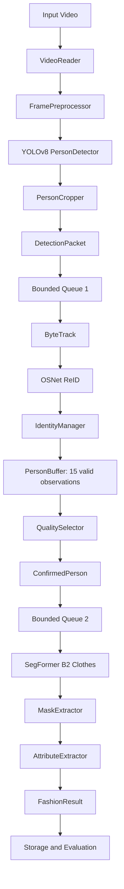

# Intended architecture

Phase 0 defines boundaries only. No feature application is implemented.

Three future application worker threads have these responsibilities:

1. Detection: video reading, frame preparation, detection and cropping.
2. Tracking: ByteTrack, OSNet, identity management, buffer and quality selection.
3. Fashion and Storage: segmentation, masks, attributes and persistence.

Two bounded queues initially hold eight packets each. Backpressure bounds packet
counts, not total bytes: frames and crops vary in size. Ordered processing and empty
detection packets preserve tracker progression. Library-internal threads are separate
from the three application workers.

Published arrays must not be mutated. Define ownership and copy boundaries. Workers
must propagate exceptions, unblock waiting peers, release resources and coordinate
end-of-stream and shutdown without deadlocks. Sentinel formats, timeouts, error
transport and reset lifecycle remain decisions for integration. Validate a sequential
application before implementing concurrency; neither is supplied here.

## Proposed buffer policy

Count valid observations from distinct frames, require fifteen, and initially allow
non-consecutive observations. Select a suitable source crop while retaining its frame
and timestamp. Confirm each anonymous identity once per video session. Explicit reset
clears session state. Preserve a session confirmation record beyond temporary buffer
expiration to prevent duplicate confirmation. Quality thresholds, expiration periods,
memory limits, duplicate-frame handling and reappearance behavior need agreement and
tests. No buffer algorithm is implemented.

Use object-oriented adapters, SOLID responsibility boundaries and dependency inversion
through shared ABCs. Keep model inference, identity logic, persistence and orchestration
separate. Shared exceptions preserve FashionVisionError for specification compatibility.
